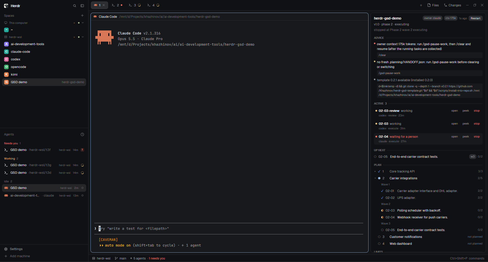
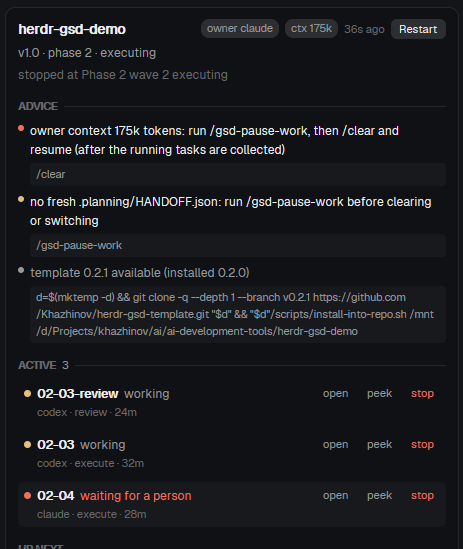
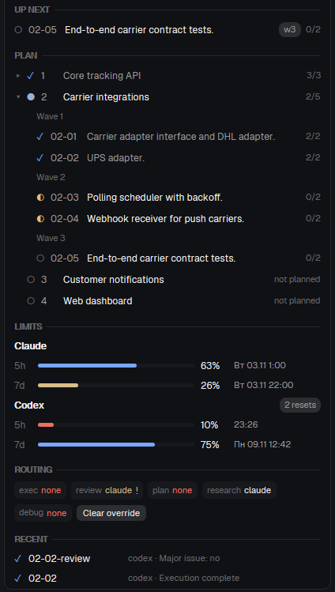

# Herdr + GSD template

English | [Русский](README.ru.md)

A public template for orchestrating development with **GSD + herdr-core + several coding agents**.

The repository holds no application code and no ready `.planning/`. It supports two scenarios:

1. start a new project;
2. lay the orchestration layer over an existing Git repository.

The owner (**Claude Code** by default) runs the GSD lifecycle and is the only writer of canonical `.planning/`.
All other work (review, plan execution, research, debugging) goes to **one-shot workers**,
which the scheduler picks by capability, live subscription quotas, reserves and review independence.
By default heavy execution goes to **Codex** while its quota stays above the reserve, then to Claude.

> The repository grew out of the talk **"Building an (almost) continuous cycle with blackjack and GSD"**.
> Talk context and announcement: [Thoughts and Bytes - conference post](https://t.me/thoughts_and_bytes/27) (in Russian).
> Author's channel: [Thoughts and Bytes](https://t.me/thoughts_and_bytes/).

## Projects used

- [Open GSD / GSD Core](https://github.com/open-gsd/gsd-core) - project lifecycle, planning artifacts, verification.
- [herdr-core](https://github.com/herdrdev/herdr-core) (`hc`) - long-lived terminals for programs and agents, parent-child links, events, machines.
- [Herdr App](https://github.com/herdrdev/herdr-app) - optional native UI; the Mission Control dashboard runs in it.
- [Claude Code](https://github.com/anthropics/claude-code) - default owner and fallback executor.
- [OpenAI Codex](https://github.com/openai/codex) - preferred executor and independent reviewer.

The template is not part of these projects and is not affiliated with their developers.

## Verified baseline

Verified on **2026-11-02** (Windows 11 + Herdr App 0.1.11 -> WSL2 Ubuntu 24.04):

| Component | Baseline |
|---|---:|
| GSD Core | `1.19.0` (pinned in bootstrap) |
| herdr-core `hc` | `>= 0.1.16` |
| Claude Code | `>= 2.1.316` |
| Codex CLI | `>= 0.165.0` |
| Node.js / npm | `>= 24` / `>= 10` (GSD requirement) |
| Python | `>= 3.11` (`tomllib`) |

v0.2 does not use the legacy Herdr TUI (`herdr agent ...`). Moving from v0.1: [MIGRATION](.orchestration/docs/MIGRATION.md).

```bash
./scripts/version-check.py --strict
./scripts/doctor.sh
```

## Architecture

```text
Human ── Herdr App (Windows/macOS/Linux) ── Mission Control (mod + layout)
                    │ SSH machine or local core
                    ▼
               herdr-core (hc)
                    │
   Owner (Claude) ──┤ scripts/orch.py: route / dispatch / wait / collect
     GSD lifecycle  │      │
     .planning/     │      ├─ quotas: Codex app-server RPC, Claude statusline, static, unknown
                    │      ├─ policy: .orchestration/routing.toml (chains, reserves, independence)
                    │      └─ registry: .orchestration/agents.toml (claude, codex, kimi, zcode, ...)
                    │
                    ├── w-<id>  Codex   execute  (worktree orch/<id>)
                    ├── w-<id>  Codex   review   (root, read-only)
                    ├── orch-<project>  hub: publishes state for the dashboard
                    └── tool-<module>   persistent tool agents (herdr-agent-kit)
```

| Layer | Responsible for |
|---|---|
| GSD | lifecycle, plans, verifier, `planning.inspect` for the dashboard |
| `scripts/orch.py` | quotas, routing, task contract, worktrees, completion evidence |
| herdr-core | processes, terminals, parent-child links, OSC statuses, events, documents, machines |
| Herdr App | human interface: worker tabs, Mission Control |
| Git | execution evidence: branch, commits, clean tree |

Details: [ARCHITECTURE](.orchestration/docs/ARCHITECTURE.md), decisions: [DECISIONS](.orchestration/docs/DECISIONS.md).

## Invariants

- Durable state = GSD artifacts + `docs/orch/` reports + task records + Git, not chat history.
- Only the `owner` from `routing.toml` changes canonical `.planning/`.
- Worker status (`working/blocked/done/idle`) is a runtime signal, not task success.
- Task success = a report with the marker on its last line + (for execution) commits on the branch with a clean tree.
- An unknown or stale quota never counts as "available": heavy work moves further down the chain.
- Crossing a reserve does not move a task that is already running.
- The reserve must survive the task: the scheduler subtracts the measured spend of the task and the expected spend of running tasks on the same account.
- A worktree is not removed while a live terminal runs inside it (`orch.py` checks with `hc ls`).
- A worktree isolates files, but not databases, ports, caches and external APIs (`.orchestration/hooks/worktree-env`).
- Public defaults never enable unrestricted permissions or auto-approval.

## New project

```bash
git clone https://github.com/Khazhinov/herdr-gsd-template.git my-project
cd my-project
git remote set-url origin <your-repository-url>
./scripts/bootstrap.sh
```

Open the folder in Herdr App (or any terminal with `hc`) and start `claude`. First prompt:

```text
Initialize this repository according to .claude/CLAUDE.md: run doctor,
start the orchestration hub, show quotas and routing, then wait for my GSD command.
```

Then `/gsd-new-project`, then `./scripts/apply-gsd-policy.py`.

## Existing repository

```bash
/path/to/herdr-gsd-template/scripts/install-into-repo.sh /path/to/repo
cd /path/to/repo
# resolve conflicts from .orchestration/merge-required/, if any
./scripts/bootstrap.sh
```

Existing files are never overwritten: the template version goes to `.orchestration/merge-required/`,
and bootstrap refuses to run until the conflicts are resolved. Then `/gsd-onboard` and `./scripts/apply-gsd-policy.py`.

## Owner work cycle

```bash
python3 scripts/orch.py quota                      # live quotas of all agents
python3 scripts/orch.py route execute              # who gets a heavy task and why
python3 scripts/orch.py dispatch task.md --role execute --id 14-01
python3 scripts/orch.py wait                       # next worker event
python3 scripts/orch.py collect 14-01              # evidence, commit, stop the worker
python3 scripts/orch.py worktree merge 14-01
```

Step-by-step protocol for the owner agent, including GSD checkpoints: [orch-workers](.agents/skills/orch-workers/SKILL.md).

### Quotas

| Agent | Source | Confidence |
|---|---|---|
| Codex | `codex app-server` -> `account/rateLimits/read` (5h/7d windows, reset credits) | `official-rpc`; fallback: session logs |
| Claude | statusline `rate_limits`, saved by `orch.py statusline-tap` | `official-statusline`, stale after 30 min |
| Others | `quota = "static"` with a budget in `agents.local.toml`, or `none` | `configured-static` / `unknown` |

Role strategies: `ordered` (first suitable agent in the chain), `cheapest` (by `cost_tier`),
`use-or-lose` (the subscription whose quota burns first: remaining percent per hour until the narrowest window resets).

### Mission Control

```bash
python3 scripts/orch.py hub start        # state publisher in its own hc terminal
./scripts/herdr-app-install.sh           # mod + "GSD Mission Control" layout in Herdr App
```

The panel appears only in an App space whose terminals run inside a project with a running hub;
in other spaces it collapses. Updates are reactive: the hub changes its terminal labels on every
change, the App redraws the mod, and worker statuses come straight from OSC 7501.

| Block | Content |
|---|---|
| Header | project, owner, milestone, phase, GSD status and stop point; Restart button for the hub |
| Advice | owner hints: compact or clear context, owner handoff, template update; click a command to copy it |
| Active | running workers: status, agent message, run time; Open, Peek, Stop |
| Up next | nearest plans not yet started |
| Plan | the whole milestone plan: ROADMAP phases, waves inside them, plans and tasks, as far as GSD knows them |
| Limits | quotas per runtime (Claude, Codex) per window, with exact reset time in the system format |
| Routing | next agent for each role, reason in the tooltip |
| Recent | latest finished tasks and tool agents |



| Advice and workers | Plan, limits, routing |
|---|---|
|  |  |

Screenshots show a fictional demo project; quotas are real.

The hub exits on its own when no live terminal works inside the project for an hour (OPERATIONS, section 4).

Without Herdr App the same snapshot is available as `python3 scripts/orch.py watch` in any terminal.

## GSD policy

`apply-gsd-policy.py` applies `.orchestration/gsd-policy.overlay.json` to `.planning/config.json`:
the built-in `plan_check` and `code_review` are off (independent workers do them),
`verifier` is on, `cross_ai_command` points to the `orch.py gsd-cross-ai` bridge (off by default),
`review.default_reviewers = ["codex"]` for the strict profile via `/gsd-review`. Rationale: [REVIEW](.orchestration/docs/REVIEW.md).

## Multiple agents

An agent is added with an entry in `.orchestration/agents.toml` and its name in the role chains of `routing.toml`.
The scheduler code contains no agent identifiers (a test checks this).
Kimi Code, OpenCode and ZCode are listed as `candidate` / `experimental` and are never picked automatically
(`auto_stability` in `routing.toml`); an explicit `--agent <id>` is allowed. OpenCode passed the smoke test
for the `research` role (COMPATIBILITY); Kimi Code and ZCode have not passed it yet. Without a vendor quota API
they need a `static` budget in `agents.local.toml`, otherwise heavy work never reaches them.

The owner can be replaced: `orch.py owner set <agent> --launch` after `/gsd-pause-work` (OPERATIONS, section 5).
`orch.py advice` and Mission Control suggest when to compact or clear the owner context,
when to hand the role over and when a new template release is out.

## Optimization stack

The machine-wide stack (code graph, shell output filter, output sandbox, answer style, minimal code
rules, Codex permission profile) is set up per agent, not per project. Its description, configuration
examples with rationale, installers and journal live in a separate repository:
[agent-token-stack](https://github.com/Khazhinov/agent-token-stack). This template adds the
project-level part below.

Context economy rules are the same for the owner and the workers and live in
`.agents/skills/gsd-context-discipline/SKILL.md`: code graph search or `rg` before wide reads,
ranged reads, no rereading of unchanged files, re-review only of the diff,
deterministic checks in one batch with only the summary printed, large logs in files, not in chat.
The task contract (`.orchestration/templates/task.md`) adds quota spending rules: a long command is
one call with the maximum timeout, no polling with `ps`/`tail`. Owner context hygiene:
`orch.py advice` (OPERATIONS, section 5.1).

`.mcp.example.json` is a starter for project-level MCP code graph or repository search.
`.orchestration/versions.env` pins the verified versions of GSD, herdr-core, agent CLIs, Node.js and
Python; `scripts/version-check.py` compares the installed versions with them; the upgrade procedure is
in OPERATIONS, section 7.

## Security

- Agents start without sandbox or approval bypass flags; local relaxations go only into
  the git-ignored `.orchestration/agents.local.toml`.
- A Codex worker gets write access to the shared `.git` (`--add-dir`) and trust only for the worktree created for it.
- A worker never confirms permission dialogs itself: `blocked` is visible in the App and the dashboard.
- Tool agents keep secrets in their own environment; the owner gets a capability, not a token.

## Checks

```bash
./scripts/test-template.sh     # static checks, overlay, reconcile, routing, quotas, lifecycle
```

CI (`.github/workflows/template-self-check.yml`) runs the offline suite and installs the pinned GSD version,
checking overlay keys against the GSD schema manifest.

## Companion repository

[herdr-agent-kit](https://github.com/Khazhinov/herdr-agent-kit) (formerly herdr-tool-agents) - machine registry of MCP folders
and service repositories with persistent, visible worker agents, reusable from any project:
`orch.py tools`, `orch.py tools-link`, `orch.py tool-ask`; service functions through `tool_ask.py call`.

## License

MIT. See [LICENSE](LICENSE).
