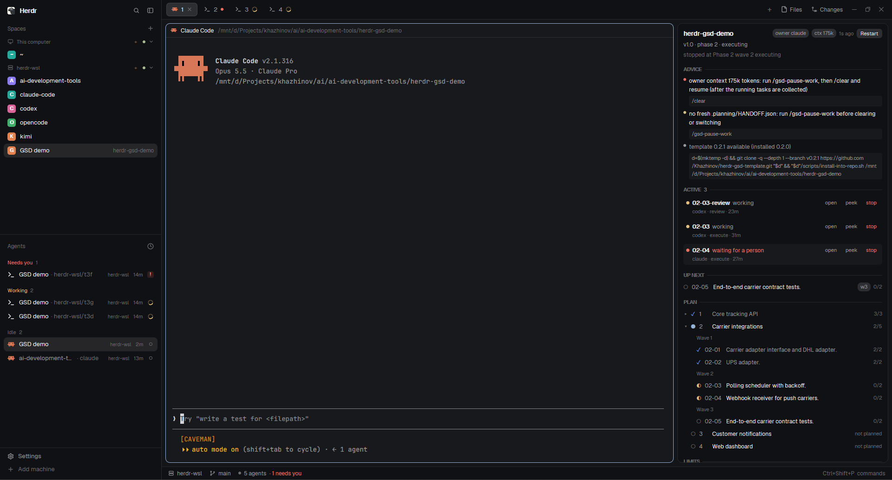
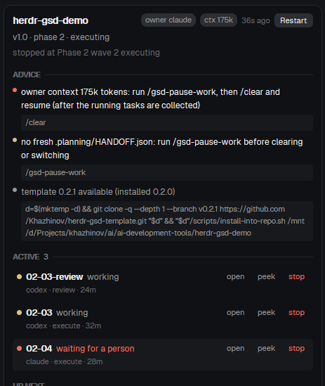
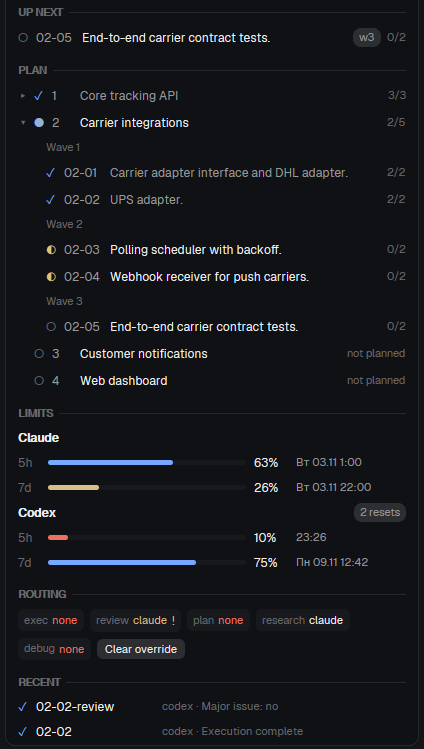

# Herdr + GSD template

[English](README.md) | Русский

Публичный шаблон оркестрации разработки по схеме **GSD + herdr-core + несколько coding-агентов**.

В репозитории нет прикладного кода и готового `.planning/`. Два сценария применения:

1. начать новый проект;
2. наложить слой оркестрации на существующий Git-репозиторий.

Владелец (по умолчанию **Claude Code**) ведёт жизненный цикл GSD и единственный пишет canonical `.planning/`.
Остальная работа (ревью, исполнение планов, исследование, отладка) уходит **одноразовым воркерам**,
которых планировщик выбирает по возможностям, живым квотам подписок, резервам и независимости ревью.
По умолчанию тяжёлое исполнение получает **Codex**, пока его квота выше резерва, затем Claude.

> Репозиторий вырос из доклада **«Разработка (почти) непрерывного цикла с блэк-джеком и GSD»**.
> Контекст выступления и анонс: [Мысли и байты - пост о конференции](https://t.me/thoughts_and_bytes/27).
> Канал автора: [Мысли и байты](https://t.me/thoughts_and_bytes/).

## Используемые проекты

- [Open GSD / GSD Core](https://github.com/open-gsd/gsd-core) - жизненный цикл проекта, артефакты планирования, верификация.
- [herdr-core](https://github.com/herdrdev/herdr-core) (`hc`) - живущие терминалы для программ и агентов, связи родитель-потомок, события, машины.
- [Herdr App](https://github.com/herdrdev/herdr-app) - необязательный нативный интерфейс; здесь в нём работает дашборд Mission Control.
- [Claude Code](https://github.com/anthropics/claude-code) - владелец по умолчанию и резервный исполнитель.
- [OpenAI Codex](https://github.com/openai/codex) - приоритетный исполнитель и независимый ревьюер.

Шаблон не является частью этих проектов и не аффилирован с их разработчиками.

## Проверенный baseline

Проверено **2026-11-02** (Windows 11 + Herdr App 0.1.11 -> WSL2 Ubuntu 24.04):

| Компонент | Baseline |
|---|---:|
| GSD Core | `1.19.0` (pin в bootstrap) |
| herdr-core `hc` | `>= 0.1.16` |
| Claude Code | `>= 2.1.316` |
| Codex CLI | `>= 0.165.0` |
| Node.js / npm | `>= 24` / `>= 10` (требование GSD) |
| Python | `>= 3.11` (`tomllib`) |

Legacy Herdr TUI (`herdr agent ...`) в v0.2 не используется. Переход с v0.1 - [MIGRATION](.orchestration/docs/MIGRATION.ru.md).

```bash
./scripts/version-check.py --strict
./scripts/doctor.sh
```

## Архитектура

```text
Human ── Herdr App (Windows/macOS/Linux) ── Mission Control (мод + раскладка)
                    │ SSH-машина или локальное ядро
                    ▼
               herdr-core (hc)
                    │
   Owner (Claude) ──┤ scripts/orch.py: route / dispatch / wait / collect
     GSD lifecycle  │      │
     .planning/     │      ├─ квоты: Codex app-server RPC, Claude statusline, static, unknown
                    │      ├─ политика: .orchestration/routing.toml (цепочки, резервы, независимость)
                    │      └─ реестр: .orchestration/agents.toml (claude, codex, kimi, zcode, ...)
                    │
                    ├── w-<id>  Codex   execute  (worktree orch/<id>)
                    ├── w-<id>  Codex   review   (корень, только чтение)
                    ├── orch-<project>  hub: публикует состояние для дашборда
                    └── tool-<module>   постоянные tool-агенты (herdr-tool-agents)
```

| Слой | Отвечает за |
|---|---|
| GSD | жизненный цикл, планы, верификатор, `planning.inspect` для дашборда |
| `scripts/orch.py` | квоты, маршрутизацию, контракт задачи, worktree, доказательства завершения |
| herdr-core | процессы, терминалы, родитель-потомок, OSC-статусы, события, документы, машины |
| Herdr App | человеческий интерфейс: вкладки воркеров, Mission Control |
| Git | доказательства исполнения: ветка, коммиты, чистое дерево |

Подробно: [ARCHITECTURE](.orchestration/docs/ARCHITECTURE.ru.md), решения - [DECISIONS](.orchestration/docs/DECISIONS.ru.md).

## Инварианты

- Устойчивое состояние = артефакты GSD + отчёты `docs/orch/` + записи задач + Git, а не история чата.
- Canonical `.planning/` меняет только `owner` из `routing.toml`.
- Статус воркера (`working/blocked/done/idle`) - сигнал среды выполнения, а не успех задачи.
- Успех задачи = отчёт с маркером в последней строке + (для исполнения) коммиты на ветке при чистом дереве.
- Неизвестная или устаревшая квота не становится «доступной»: тяжёлая работа уходит дальше по цепочке.
- Пересечение резерва не переносит уже идущую задачу.
- Резерв должен сохраниться после задачи: планировщик вычитает измеренный расход задачи и ожидаемый расход уже идущих задач той же учётной записи.
- Worktree не удаляется, пока внутри работает живой терминал (`orch.py` проверяет через `hc ls`).
- Worktree изолирует файлы, но не БД, порты, кэши и внешние API (`.orchestration/hooks/worktree-env`).
- Публичные значения по умолчанию не включают неограниченные права и автоподтверждение.

## Новый проект

```bash
git clone https://github.com/Khazhinov/herdr-gsd-template.git my-project
cd my-project
git remote set-url origin <your-repository-url>
./scripts/bootstrap.sh
```

Откройте папку в Herdr App (или любом терминале с `hc`), запустите `claude`. Первый запрос:

```text
Initialize this repository according to .claude/CLAUDE.md: run doctor,
start the orchestration hub, show quotas and routing, then wait for my GSD command.
```

Далее `/gsd-new-project`, затем `./scripts/apply-gsd-policy.py`.

## Существующий репозиторий

```bash
/path/to/herdr-gsd-template/scripts/install-into-repo.sh /path/to/repo
cd /path/to/repo
# разрешить конфликты из .orchestration/merge-required/, если они есть
./scripts/bootstrap.sh
```

Существующие файлы не перезаписываются: шаблонная версия кладётся в `.orchestration/merge-required/`,
bootstrap отказывается работать, пока конфликты не разрешены. Затем `/gsd-onboard` и `./scripts/apply-gsd-policy.py`.

## Рабочий цикл владельца

```bash
python3 scripts/orch.py quota                      # живые квоты всех агентов
python3 scripts/orch.py route execute              # кто получит тяжёлую задачу и почему
python3 scripts/orch.py dispatch task.md --role execute --id 14-01
python3 scripts/orch.py wait                       # следующее событие воркеров
python3 scripts/orch.py collect 14-01              # доказательства, коммит, остановка воркера
python3 scripts/orch.py worktree merge 14-01
```

Пошаговый протокол для агента-владельца, включая точки GSD: [orch-workers](.agents/skills/orch-workers/SKILL.md).

### Квоты

| Агент | Источник | Достоверность |
|---|---|---|
| Codex | `codex app-server` -> `account/rateLimits/read` (окна 5ч/7д, кредиты сброса) | `official-rpc`; запасной путь - журналы сессий |
| Claude | данные `rate_limits` из statusline, сохраняемые `orch.py statusline-tap` | `official-statusline`, устаревает через 30 мин |
| Прочие | `quota = "static"` с бюджетом в `agents.local.toml` или `none` | `configured-static` / `unknown` |

Стратегии ролей: `ordered` (первый подходящий по цепочке), `cheapest` (по `cost_tier`),
`use-or-lose` (подписка, чья квота сгорит раньше: остаток в процентах на час до сброса самого узкого окна).

### Mission Control

```bash
python3 scripts/orch.py hub start        # публикатор состояния в отдельном терминале hc
./scripts/herdr-app-install.sh           # мод + раскладка "GSD Mission Control" в Herdr App
```

Панель показывается только в пространстве App, чьи терминалы работают внутри проекта с запущенным hub;
в остальных пространствах она сворачивается. Обновление реактивное: hub меняет метки своего терминала
при каждом изменении, App перерисовывает мод, статусы воркеров берутся напрямую из OSC 7501.

| Блок | Содержание |
|---|---|
| Заголовок | проект, владелец, веха, фаза, статус и точка остановки GSD; кнопка Restart для hub |
| Advice | подсказки владельцу: сжатие или очистка контекста, передача роли, обновление шаблона; щелчок по команде копирует её |
| Active | работающие воркеры: статус, сообщение агента, время работы; Open, Peek, Stop |
| Up next | ближайшие незапущенные планы |
| Plan | весь план вехи: фазы ROADMAP, внутри волны, планы и задачи, насколько GSD их уже знает |
| Limits | квоты по средам (Claude, Codex) по окнам с точным временем сброса в формате системы |
| Routing | агент следующей задачи каждой роли, причина во всплывающей подсказке |
| Recent | последние завершённые задачи и tool-агенты |



| Подсказки и воркеры | План, квоты, маршрутизация |
|---|---|
|  |  |

На снимках вымышленный демопроект; квоты реальные.

Hub завершается сам, если в проекте час нет живого терминала (OPERATIONS, раздел 4).

Без Herdr App тот же снимок: `python3 scripts/orch.py watch` в любом терминале.

## Политика GSD

`apply-gsd-policy.py` накладывает `.orchestration/gsd-policy.overlay.json` на `.planning/config.json`:
встроенные `plan_check` и `code_review` выключены (их выполняют независимые воркеры),
`verifier` включён, `cross_ai_command` указывает на мост `orch.py gsd-cross-ai` (выключен по умолчанию),
`review.default_reviewers = ["codex"]` для строгого профиля через `/gsd-review`. Обоснование - [REVIEW](.orchestration/docs/REVIEW.ru.md).

## Многоагентность

Агент добавляется записью в `.orchestration/agents.toml` и именем в цепочках ролей `routing.toml`.
Код планировщика не содержит идентификаторов агентов (это проверяет тест).
Kimi Code, OpenCode и ZCode описаны как `candidate` / `experimental` и не выбираются автоматически
(`auto_stability` в `routing.toml`); вызов `--agent <id>` допустим. OpenCode прошёл smoke-тест
роли `research` (COMPATIBILITY), Kimi Code и ZCode его ещё не проходили. Без API квоты вендора им задаётся
`static` бюджет в `agents.local.toml`, иначе тяжёлая работа к ним не попадает.

Владелец сменяем: `orch.py owner set <agent> --launch` после `/gsd-pause-work` (OPERATIONS, раздел 5).
`orch.py advice` и Mission Control подсказывают, когда сжать или очистить контекст владельца,
когда передать роль и когда вышла новая версия шаблона.

## Стек оптимизации

Стек уровня машины (граф кода, фильтр вывода оболочки, песочница выводов, стиль ответов, правила
минимального кода, профиль прав Codex) настраивается для агента, а не для проекта. Его описание,
примеры конфигурации с обоснованием, установщики и журнал - в отдельном репозитории
[agent-token-stack](https://github.com/Khazhinov/agent-token-stack). Шаблон добавляет часть уровня
проекта, описанную ниже.

Правила экономии контекста одинаковы для владельца и воркеров и описаны в
`.agents/skills/gsd-context-discipline/SKILL.md`: поиск по графу кода или `rg` до широкого чтения,
чтение диапазонов, без повторного чтения неизменённых файлов, повторное ревью только по разнице,
детерминированные проверки пакетом с выводом только итога, крупные журналы в файлах, а не в чате.
Контракт задачи (`.orchestration/templates/task.md`) добавляет правила расхода квоты: длинная команда -
один вызов с максимальным ожиданием, без опроса `ps`/`tail`. Гигиена контекста самого владельца -
`orch.py advice` (OPERATIONS, раздел 5.1).

`.mcp.example.json` - заготовка подключения MCP графа кода или поиска по репозиторию на уровне проекта.
`.orchestration/versions.env` фиксирует проверенные версии GSD, herdr-core, CLI агентов, Node.js и
Python; `scripts/version-check.py` сверяет с ними установленные версии, порядок обновления -
OPERATIONS, раздел 7.

## Безопасность

- Агенты запускаются без флагов обхода песочницы и подтверждений; локальные послабления -
  только в git-игнорируемом `.orchestration/agents.local.toml`.
- Codex-воркер получает запись в общий `.git` (`--add-dir`) и доверие только к созданному worktree.
- Воркер не подтверждает диалоги разрешений сам: `blocked` виден в App и дашборде.
- Tool-агенты держат секреты в своём окружении; владелец получает возможность, а не токен.

## Проверки

```bash
./scripts/test-template.sh     # статические проверки, overlay, reconcile, маршрутизация, квоты, жизненный цикл
```

CI (`.github/workflows/template-self-check.yml`) выполняет офлайн-набор и установку закреплённой версии GSD
с проверкой ключей overlay по манифесту схемы GSD.

## Сопутствующий репозиторий

[herdr-tool-agents](https://github.com/Khazhinov/herdr-tool-agents) - постоянные tool/MCP-агенты
(GitHub, GitLab, Portainer), переиспользуемые из любого проекта: `orch.py tools`, `orch.py tool-ask`.

## License

MIT. См. [LICENSE](LICENSE).
